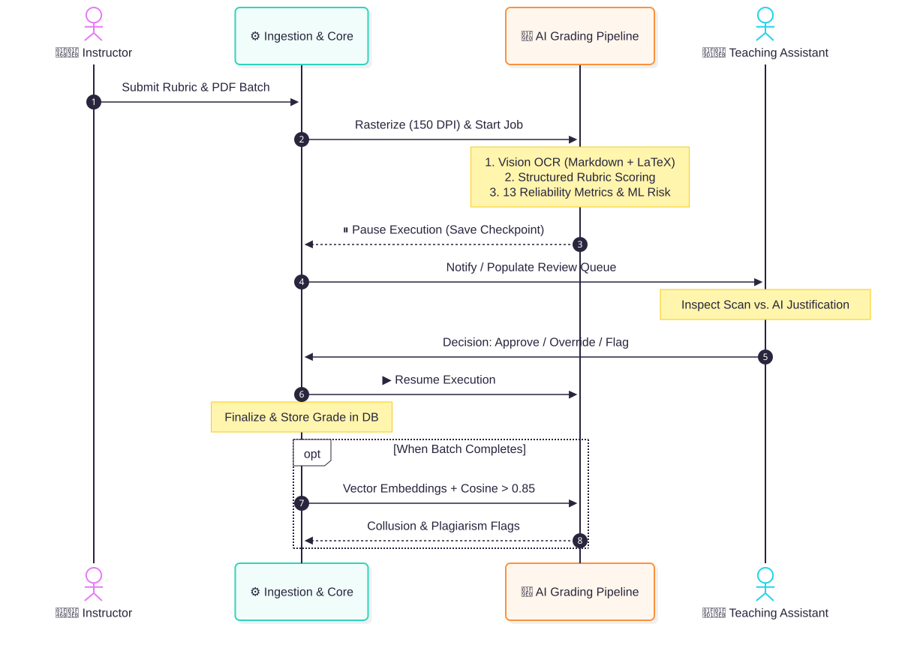
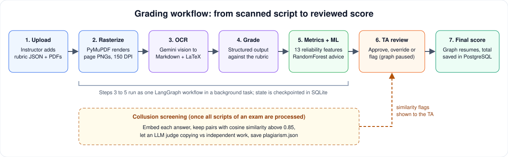

<a id="readme-top"></a>

<!-- PROJECT SHIELDS -->
[![Contributors][contributors-shield]][contributors-url]
[![Forks][forks-shield]][forks-url]
[![Stargazers][stars-shield]][stars-url]
[![Issues][issues-shield]][issues-url]
[![GitHub][github-shield]][github-url]

<!-- PROJECT LOGO -->
<br />
<div align="center">
  <a href="https://github.com/Gunasekhar00212/GradEngine">
    
  </a>

  <h3 align="center">AI Based Handwritten Answer Evaluation Framework</h3>

  <p align="center">
    Grade scanned handwritten answer scripts against a rubric with multimodal AI, keep a teaching assistant in charge of the final mark, and screen answers for copying.
    <br />
    <a href="https://github.com/Gunasekhar00212/GradEngine"><strong>Explore the code »</strong></a>
    <br />
    <br />
    <a href="#usage">How it is used</a>
    &middot;
    <a href="https://github.com/Gunasekhar00212/GradEngine/issues/new">Report Bug</a>
    &middot;
    <a href="https://github.com/Gunasekhar00212/GradEngine/issues/new">Request Feature</a>
  </p>
</div>

<!-- TABLE OF CONTENTS -->
<details>
  <summary>Table of Contents</summary>
  <ol>
    <li>
      <a href="#about-the-project">About The Project</a>
      <ul>
        <li><a href="#key-features">Key Features</a></li>
        <li><a href="#how-it-works">How It Works</a></li>
        <li><a href="#built-with">Built With</a></li>
      </ul>
    </li>
    <li>
      <a href="#getting-started">Getting Started</a>
      <ul>
        <li><a href="#prerequisites">Prerequisites</a></li>
        <li><a href="#installation">Installation</a></li>
      </ul>
    </li>
    <li><a href="#usage">Usage</a></li>
    <li><a href="#project-structure">Project Structure</a></li>
    <li><a href="#api-overview">API Overview</a></li>
    <li><a href="#known-limitations">Known Limitations</a></li>
    <li><a href="#roadmap">Roadmap</a></li>
    <li><a href="#contributing">Contributing</a></li>
    <li><a href="#license">License</a></li>
    <li><a href="#contact">Contact</a></li>
    <li><a href="#acknowledgments">Acknowledgments</a></li>
  </ol>
</details>

<!-- ABOUT THE PROJECT -->
## About The Project

<p align="center">
  
</p>

<!--
Add real screenshots of your running app here, for example:
<p align="center">
  
  
</p>
-->

Grading handwritten exam scripts by hand is slow and inconsistent. This framework lets an instructor upload a batch of scanned scripts together with a marking rubric. The system reads the handwriting, scores each question against the rubric, explains every score, and flags answers that look unreliable or copied.

Nothing is final until a teaching assistant (TA) has reviewed it. The AI does the first pass and the triage; the human stays the decision-maker.

### Key Features

* **Rubric-grounded grading.** Instructors define questions and criteria (name, max points, keywords) as JSON. The model returns per-criterion points, a status (full, partial or none), a justification and a confidence value.
* **Handwriting OCR with a vision model.** Pages are transcribed to Markdown with LaTeX for math.
* **Human-in-the-loop review.** The LangGraph workflow pauses at an interrupt and is checkpointed in SQLite, so a TA can review hours or days later. The TA approves, overrides a score with a reason, or flags each question.
* **Reliability indicators.** Thirteen metrics per answer (OCR quality, image sharpness, rubric coverage, semantic alignment and more) plus an advisory RandomForest "needs review" signal. The model is trained on synthetic data and is labeled experimental in the UI payload.
* **Collusion screening.** Answers are embedded, pairs above 0.85 cosine similarity are judged by an LLM, and the results appear as similarity flags in the TA queue.
* **Role-based dashboards** for instructors and TAs, with a keyboard-driven review screen and a page viewer next to the AI result.

### How It Works

<p align="center">
  
</p>

1. The instructor creates an exam with a JSON rubric and uploads one PDF per student. The file name (without extension) becomes the student roll number.
2. The backend rasterizes each PDF to PNG pages at 150 DPI and queues a background grading task.
3. A LangGraph workflow runs OCR, rubric grading and metrics, then pauses for human review.
4. The TA reviews each question and submits; the workflow resumes, the total is stored and the script is marked completed.
5. When every script of an exam has been processed, a one-time batch check looks for suspiciously similar answers.

<p align="right">(<a href="#readme-top">back to top</a>)</p>

### Built With

* [![Python][Python.org]][Python-url]
* [![FastAPI][FastAPI.tiangolo]][FastAPI-url]
* [![LangChain][LangChain.com]][LangChain-url]
* [![Google Gemini][Gemini.google]][Gemini-url]
* [![scikit-learn][Sklearn.org]][Sklearn-url]
* [![PostgreSQL][Postgres.org]][Postgres-url]
* [![SQLite][SQLite.org]][SQLite-url]
* [![React][React.js]][React-url]
* [![Vite][Vite.dev]][Vite-url]

Other key libraries: SQLAlchemy, Pydantic, PyJWT, pwdlib (Argon2), PyMuPDF, LangGraph, axios, framer-motion and react-router.

<p align="right">(<a href="#readme-top">back to top</a>)</p>

<!-- GETTING STARTED -->
## Getting Started

Follow these steps to run the project locally.

### Prerequisites

* Python 3.12 (the version the repository was developed with)
* Node.js (current LTS) and npm
* A running PostgreSQL server
* A Google Gemini API key from [Google AI Studio](https://aistudio.google.com/apikey)

### Installation

1. Clone the repo
   ```sh
   git clone https://github.com/Gunasekhar00212/GradEngine.git
   cd GradEngine
   ```
2. Create the database
   ```sh
   createdb gradeops_db
   ```
3. Set up the backend
   ```sh
   cd backend
   python -m venv venv
   source venv/bin/activate        # Windows: venv\Scripts\activate
   pip install -r requirements.txt
   pip install pandas opencv-python-headless
   ```
   `pandas` and OpenCV are used by the code but are not listed in `requirements.txt`, so install them explicitly.
4. Create `backend/.env` from the example and fill it in
   ```sh
   cp .env.example .env
   ```
   ```ini
   SQLALCHEMY_DATABASE_URL = "postgresql+psycopg2://<USER>:<PASSWORD>@localhost/gradeops_db"
   SECRET_KEY = "a-long-random-string"
   COOKIE_SECURE = "false"            # keep false for local http, set true behind https
   ACCESS_TOKEN_EXPIRE_MINUTES = 60
   GOOGLE_API_KEY = "your-google-gemini-api-key"
   ```
   `OPENROUTER_API_KEY` appears in the example file but is not used by the current code.
5. Start the API from the `backend` folder (tables are created automatically on startup)
   ```sh
   uvicorn app.main:app --reload
   ```
   The API runs at `http://localhost:8000` and the interactive docs at `http://localhost:8000/docs`.
6. In a second terminal, start the frontend
   ```sh
   cd frontend
   npm install
   npm run dev
   ```
   Open `http://localhost:5173`. The API address is currently hard-coded in `frontend/src/services/api.jsx`.

<p align="right">(<a href="#readme-top">back to top</a>)</p>

<!-- USAGE EXAMPLES -->
## Usage

**As an instructor**

1. Register with the role **instructor** and log in.
2. Paste a rubric in this shape and add your scanned PDFs, one per student, named by roll number (for example `21B91A5801.pdf`):
   ```json
   {
     "exam": "MATH201 Midterm",
     "questions": [
       {
         "id": "Q3b",
         "text": "Evaluate the definite integral of sin(x) from 0 to pi and justify each step.",
         "criteria": [
           { "name": "Antiderivative setup", "maxPoints": 3, "keywords": ["-cos(x)", "antiderivative"] },
           { "name": "Final answer", "maxPoints": 2, "keywords": ["2"] }
         ]
       }
     ]
   }
   ```
3. Upload. Each script moves from `processing` to `pending_review` once the AI pass finishes.
4. Follow scores in the grades table. Releasing grades to students is not implemented yet.

**As a teaching assistant**

1. Register with the role **ta** and log in.
2. Open an exam from the list to see the review queue. Each item shows the AI score, justification, rubric breakdown, quality indicators, any similarity flag, and the original page images.
3. Decide per question: approve (`A`), override the score with a reason (`O`), or flag. Use the left and right arrow keys to move between items.
4. When all questions of a script are decided, the review is submitted and the script is marked completed.

<p align="right">(<a href="#readme-top">back to top</a>)</p>

<!-- PROJECT STRUCTURE -->
## Project Structure

```text
GradEngine/
├── backend/
│   ├── app/                      # FastAPI app, models, schemas, auth, DB session
│   │   ├── main.py
│   │   ├── models.py             # User, Exam, Submission
│   │   ├── schemas.py
│   │   ├── auth.py               # JWT cookie auth
│   │   └── database.py
│   ├── routers/                  # register, login, users, exams, submissions (/upload)
│   ├── ai_engine/
│   │   ├── graph.py              # LangGraph: OCR -> grade -> metrics -> human review
│   │   └── plagiarism.py         # embeddings + LLM pair adjudication
│   ├── ml_model/
│   │   ├── grading_reliability.py   # 13 features + advisory model
│   │   ├── train_model.py           # trains the RandomForest
│   │   └── synthetic_*.{csv,joblib,json}
│   ├── requirements.txt
│   └── .env.example
└── frontend/
    └── src/
        ├── pages/                # Home, Login, Register, InstructorDashboard, TADashboard
        ├── components/           # Sidebar, shared UI
        ├── context/UserContext.jsx
        └── services/api.jsx
```

<p align="right">(<a href="#readme-top">back to top</a>)</p>

<!-- API OVERVIEW -->
## API Overview

| Method and path | Purpose |
| --- | --- |
| `POST /register/`, `POST /login/` | Create an account, log in (sets an httpOnly cookie) |
| `GET /users/me`, `GET /users/logout` | Current session, log out |
| `POST /exams/`, `GET /exams/`, `PATCH /exams/{id}/`, `DELETE /exams/{id}/` | Exam management (instructor) |
| `GET /exams/to-grade` | Exams with scripts waiting for a TA |
| `GET /exams/{id}/queue` | Review queue with similarity flags |
| `POST /upload/` | Bulk upload scripts and start grading |
| `GET /upload/{id}/review`, `POST /upload/{id}/review` | Fetch and submit a TA review |
| `GET /upload/{id}/pages`, `GET /upload/{id}/page/{n}` | Page images |
| `GET /upload/instructor_exams` | Instructor grades table |

Full interactive documentation is served at `/docs` while the backend is running.

<p align="right">(<a href="#readme-top">back to top</a>)</p>

<!-- KNOWN LIMITATIONS -->
## Known Limitations

This is a working prototype and is **not ready for real exam data yet**.

* **Security:** roles are chosen at registration, the page-image and review-queue endpoints do not require login, and exam delete and upload do not check ownership.
* **Privacy:** handwriting images and OCR text are sent to Google's Gemini API.
* **ML model:** the reliability model is trained on synthetic labels only, so its reported accuracy is not a measure of real grading quality. No comparison against human graders has been run yet.
* **Operations:** grading runs inside the web process with no job queue, and there are no automated tests, CI or Docker setup.

<p align="right">(<a href="#readme-top">back to top</a>)</p>

<!-- ROADMAP -->
## Roadmap

- [x] Rubric JSON exams and bulk PDF upload
- [x] Gemini vision OCR and rubric-based structured grading
- [x] Human review gate with LangGraph checkpoints
- [x] Reliability metrics and advisory ML recommendation
- [x] Batch collusion screening
- [x] Instructor and TA dashboards
- [ ] Authenticate every endpoint, add ownership checks, and restrict how roles are assigned
- [ ] Store the original AI output and the reviewer separately from the final score
- [ ] Add tests (pytest and Vitest), CI, a Dockerfile and a compose file
- [ ] Move grading to a durable job queue
- [ ] Release grades to students
- [ ] Evaluate AI grades against human grades and replace the synthetic model with real labels
    - [ ] Collect TA decisions as training labels

See the [open issues](https://github.com/Gunasekhar00212/GradEngine/issues) for proposed features and known issues.

<p align="right">(<a href="#readme-top">back to top</a>)</p>

<!-- CONTRIBUTING -->
## Contributing

Contributions are what make the open source community such an amazing place to learn, inspire, and create. Any contributions you make are **greatly appreciated**.

If you have a suggestion that would make this better, please fork the repo and create a pull request. You can also simply open an issue with the tag "enhancement". Don't forget to give the project a star! Thanks again!

1. Fork the Project
2. Create your Feature Branch (`git checkout -b feature/AmazingFeature`)
3. Commit your Changes (`git commit -m 'Add some AmazingFeature'`)
4. Push to the Branch (`git push origin feature/AmazingFeature`)
5. Open a Pull Request

### Top contributors

<a href="https://github.com/Gunasekhar00212/GradEngine/graphs/contributors">
  
</a>

<p align="right">(<a href="#readme-top">back to top</a>)</p>

<!-- LICENSE -->
## License

No license file is included in the repository yet. Add a `LICENSE` file (for example MIT) and update this section before accepting outside contributions.

<p align="right">(<a href="#readme-top">back to top</a>)</p>

<!-- CONTACT -->
## Contact

Ande Guna Sekhar - [@Gunasekhar00212](https://github.com/Gunasekhar00212)

Project Link: [https://github.com/Gunasekhar00212/GradEngine](https://github.com/Gunasekhar00212/GradEngine)

<p align="right">(<a href="#readme-top">back to top</a>)</p>

<!-- ACKNOWLEDGMENTS -->
## Acknowledgments

* [Best-README-Template](https://github.com/othneildrew/Best-README-Template) for the README structure
* [Google Gemini](https://ai.google.dev/) for vision, grading and embedding models
* [LangChain and LangGraph](https://www.langchain.com/) for the workflow engine and human-review interrupts
* [FastAPI](https://fastapi.tiangolo.com/), [SQLAlchemy](https://www.sqlalchemy.org/) and [Pydantic](https://docs.pydantic.dev/)
* [PyMuPDF](https://pymupdf.readthedocs.io/) for PDF rasterization
* [scikit-learn](https://scikit-learn.org/) for the reliability model
* [React](https://react.dev/) and [Vite](https://vite.dev/)
* [Img Shields](https://shields.io) for the badges

<p align="right">(<a href="#readme-top">back to top</a>)</p>

<!-- MARKDOWN LINKS & IMAGES -->
[contributors-shield]: https://img.shields.io/github/contributors/Gunasekhar00212/GradEngine.svg?style=for-the-badge
[contributors-url]: https://github.com/Gunasekhar00212/GradEngine/graphs/contributors
[forks-shield]: https://img.shields.io/github/forks/Gunasekhar00212/GradEngine.svg?style=for-the-badge
[forks-url]: https://github.com/Gunasekhar00212/GradEngine/network/members
[stars-shield]: https://img.shields.io/github/stars/Gunasekhar00212/GradEngine.svg?style=for-the-badge
[stars-url]: https://github.com/Gunasekhar00212/GradEngine/stargazers
[issues-shield]: https://img.shields.io/github/issues/Gunasekhar00212/GradEngine.svg?style=for-the-badge
[issues-url]: https://github.com/Gunasekhar00212/GradEngine/issues
[github-shield]: https://img.shields.io/badge/-GitHub-black.svg?style=for-the-badge&logo=github&colorB=555
[github-url]: https://github.com/Gunasekhar00212
[Python.org]: https://img.shields.io/badge/Python-3776AB?style=for-the-badge&logo=python&logoColor=white
[Python-url]: https://www.python.org/
[FastAPI.tiangolo]: https://img.shields.io/badge/FastAPI-009688?style=for-the-badge&logo=fastapi&logoColor=white
[FastAPI-url]: https://fastapi.tiangolo.com/
[LangChain.com]: https://img.shields.io/badge/LangGraph-1C3C3C?style=for-the-badge&logo=langchain&logoColor=white
[LangChain-url]: https://www.langchain.com/langgraph
[Gemini.google]: https://img.shields.io/badge/Google%20Gemini-8E75B2?style=for-the-badge&logo=googlegemini&logoColor=white
[Gemini-url]: https://ai.google.dev/
[Sklearn.org]: https://img.shields.io/badge/scikit--learn-F7931E?style=for-the-badge&logo=scikitlearn&logoColor=white
[Sklearn-url]: https://scikit-learn.org/
[Postgres.org]: https://img.shields.io/badge/PostgreSQL-4169E1?style=for-the-badge&logo=postgresql&logoColor=white
[Postgres-url]: https://www.postgresql.org/
[SQLite.org]: https://img.shields.io/badge/SQLite-003B57?style=for-the-badge&logo=sqlite&logoColor=white
[SQLite-url]: https://www.sqlite.org/
[React.js]: https://img.shields.io/badge/React-20232A?style=for-the-badge&logo=react&logoColor=61DAFB
[React-url]: https://reactjs.org/
[Vite.dev]: https://img.shields.io/badge/Vite-646CFF?style=for-the-badge&logo=vite&logoColor=white
[Vite-url]: https://vite.dev/
